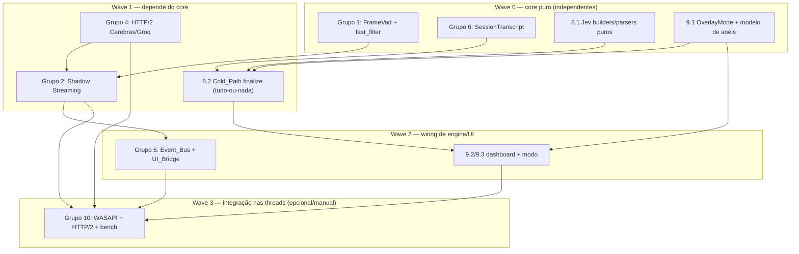

# Implementation Plan: Dual-Path Speculative Pipeline

## Overview

A implementação segue ordem incremental: primeiro a **lógica pura e testável do core** (RMS/VAD de frame, filtro rápido do `DecisionPolicy`, transições nomeadas da máquina Shadow Streaming, seleção de endpoint/keep-alive, coalescência de redesenho, `SessionTranscript`, builders/parsers do `JevAnalyticsClient`, modelo de anéis/theta/normalização de feedback) com seus **testes property-based** validando as Properties 1–20 do design; e **só então** a integração Win32/rede (thread de captura WASAPI, orquestrador do engine, workers WinHTTP, bridge de UI e renderização Direct2D do dashboard).

O design **estende** componentes existentes — as tarefas editam arquivos atuais em vez de reescrevê-los — e adiciona poucos arquivos net-new.

Arquivos **editados (existentes)**:
- `src/audio_wasapi/src/wasapi_capture.cpp` (gate do `FrameVad` na thread de captura)
- `src/core/include/rtai/decision_policy.hpp` (`fast_filter`)
- `src/core/src/copilot_engine.cpp` + `src/core/include/rtai/copilot_engine.hpp` (Shadow Streaming, bus, `SessionTranscript`, Cold_Path wiring)
- `src/core/include/rtai/copilot_events.hpp` (`OverlayModeEvent`, novos inputs/eventos)
- `src/net/src/winhttp_llm_client.cpp` + `src/net/include/rtai/winhttp_llm_client.hpp` (endpoint Cerebras/Groq, keep-alive, RST_STREAM)
- `src/overlay/src/overlay_window.cpp` + `src/overlay/include/rtai/overlay_window.hpp` (`OverlayMode`, bridge, dashboard)

Arquivos **net-new**:
- `src/core/include/rtai/frame_vad.hpp`
- `src/core/include/rtai/session_transcript.hpp`
- `src/net/include/rtai/jev_analytics_client.hpp` + `src/net/src/jev_analytics_client.cpp`
- `OverlayMode` (enum) e `OverlayModeEvent` (nos headers acima)

A linguagem de implementação é **C++20** (projeto Win32 + Direct2D/DirectWrite/WASAPI + CMake), com property-based testing em **GoogleTest** (amostragem semeada `std::mt19937` + casos de fronteira nomeados), seguindo o estilo de `tests/core_tests/test_hud_properties.cpp`.

## Tasks

- [x] 1. Hot_Path core — `FrameVad` + filtro rápido do `DecisionPolicy`
  - [x] 1.1 Implementar `FrameVad` puro em `frame_vad.hpp`
    - Criar `src/core/include/rtai/frame_vad.hpp` com `FrameVadConfig`, `FrameVadResult` e `class FrameVad`
    - `static double frame_rms(const std::int16_t*, std::size_t)` no domínio [0,32767], sem alocação
    - `on_frame()` atualiza o Noise_Floor rolante (attack/release), classifica silêncio por `rms < noise_floor * margin`, avança os streaks de 110 ms (6 frames) e 120 ms e emite `speculative_edge`/`commit_silence_edge` apenas na borda; `reset()` zera o estado por turno
    - _Requirements: 1.1, 1.2, 1.3, 3.1, 3.3_

  - [x] 1.2 Escrever property test para RMS do frame
    - **Property 1: RMS do frame fica no domínio e escala monotonicamente**
    - Novo arquivo `tests/core_tests/test_frame_vad_properties.cpp`; frame todo-zero → 0; escala por k∈[0,1] nunca aumenta o RMS
    - **Validates: Requirements 1.1**

  - [x] 1.3 Escrever property test para classificação de silêncio
    - **Property 2: Classificação de silêncio é o limiar exato (`rms < noise_floor * margin`)**
    - **Validates: Requirements 1.2**

  - [x] 1.4 Implementar `DecisionPolicy::fast_filter` em `decision_policy.hpp`
    - Adicionar método puro `bool fast_filter(std::string_view) const` reaproveitando `looks_like_question()` e exigindo `word_count > 5`; mais estrito que `would_trigger()` (sem keyword/long-turn/cooldown)
    - _Requirements: 1.4_

  - [x] 1.5 Escrever property test para o filtro rápido
    - **Property 3: Filtro rápido aprova sse >5 palavras E estrutura de pergunta** (fronteiras em 5 e 6 palavras)
    - **Validates: Requirements 1.4**

  - [x] 1.6 Escrever property test para o disparo especulativo gated
    - **Property 4: Disparo especulativo exige streak de 110 ms contínuo gated pelo filtro rápido** (frame não-silencioso reinicia o streak; `fast_ok=false` nunca dispara); oráculo de referência independente para a série temporal
    - **Validates: Requirements 1.3, 1.5**

- [x] 2. Shadow Streaming — máquina de estados no `CopilotEngine`
  - [x] 2.1 Formalizar `ShadowState` e estender `struct Shadow`/inputs
    - Em `copilot_engine.hpp`/`copilot_engine.cpp`: adicionar `enum class ShadowState { Idle, Speculating, Committed, Aborted }`, campos `state`/`shadow_buffer_`/`commit_deadline_ms` no `Shadow`, `generation_id_` como gating, e os inputs `InVadSpeculate`/`InVadCommitSilence`/`InSpeechFinal` no `using Input`
    - _Requirements: 2.1, 2.3, 2.5_

  - [x] 2.2 Implementar `enter_speculating` e gating por geração em `on_shadow_delta`
    - `enter_speculating`: `++generation_id_`, estado Speculating, inicia LLM, publica `SpeculativeCandidateEvent` ("Generating answer..."), arma `commit_deadline_ms`
    - `on_shadow_delta(gen, d)`: descarta se `gen != generation_id_`; em Speculating anexa a `shadow_buffer_` (oculto); em Committed publica `SuggestionDeltaEvent` (visível)
    - _Requirements: 2.1, 2.4, 2.5, 2.6_

  - [x] 2.3 Implementar `commit_shadow` e `abort_shadow`
    - `commit_shadow`: Speculating→Committed, publica `SpeculativeHitEvent` e promove o `shadow_buffer_` como primeiro conteúdo visível (≤16 ms)
    - `abort_shadow`: `++generation_id_`, limpa `shadow_buffer_`, `ctx->cancelled=true`, `call->cancel()` (RST_STREAM), sem tocar o card visível (sem flicker)
    - _Requirements: 2.2, 2.3, 2.6_

  - [x] 2.4 Implementar o gatilho de commit `maybe_commit` e a divergência no fechamento
    - Avaliar `maybe_commit` em `InSpeechFinal`, `InVadCommitSilence` e no tick (timeout `commit_deadline_ms`): commita no primeiro de {speech_final, 120 ms de silêncio local} com a causa correta
    - No `on_turn`, usar `speculative_match` existente: casa → `commit_shadow`; diverge → `abort_shadow` + nova geração para o turno fechado
    - _Requirements: 3.1, 3.2, 3.3, 3.4_

  - [x] 2.5 Escrever property test para buffering oculto em Speculating
    - **Property 5: Durante Speculating nada é exibido e o buffer é a concatenação dos deltas**
    - Novo arquivo `tests/core_tests/test_shadow_streaming_properties.cpp`; usa `ILlmClient` fake injetando deltas com geração controlada
    - **Validates: Requirements 2.1, 2.4**

  - [x] 2.6 Escrever property test para descarte de geração obsoleta
    - **Property 6: Tokens de geração obsoleta (`gen != generation_id_`) não têm efeito**
    - **Validates: Requirements 2.5**

  - [x] 2.7 Escrever property test para append pós-commit
    - **Property 7: Após o commit, a resposta visível é o buffer promovido seguido dos deltas subsequentes (byte-a-byte)**
    - **Validates: Requirements 2.2, 2.6**

  - [x] 2.8 Escrever property test para abort
    - **Property 8: Abortar incrementa estritamente a geração e descarta o buffer sem afetar o card visível**
    - **Validates: Requirements 2.3**

  - [x] 2.9 Escrever property test para o gatilho de commit
    - **Property 9: Commit ocorre no primeiro de {speech_final, 120 ms de silêncio local}** (min(t1,t2); causa = evento mais cedo); oráculo de referência da linha do tempo
    - **Validates: Requirements 3.1, 3.2, 3.3**

  - [x] 2.10 Escrever property test para casamento especulativo
    - **Property 10: `speculative_match` decide commit vs abort e é reflexivo/prefixo-fechado**
    - **Validates: Requirements 3.4**

- [x] 3. Checkpoint - Ensure all tests pass
  - Ensure all tests pass, ask the user if questions arise.

- [x] 4. Transporte HTTP/2 direto — Cerebras primário / Groq fallback
  - [x] 4.1 Estender `WinHttpLlmOptions` com endpoints e timeouts, e lógica pura de seleção
    - Em `winhttp_llm_client.hpp`: `struct LlmEndpoint` (host/path/model/api_key), `primary` (Cerebras `api.cerebras.ai`, `llama-3.3-70b`), `fallback` (Groq `api.groq.com`, `llama-3.3-70b-versatile`), `first_byte_timeout_ms`, `receive_timeout_ms`, `keep_alive_ms{25000}`
    - Funções puras `const LlmEndpoint& choose_endpoint(int attempt, const WinHttpLlmOptions&)` e `bool is_retryable(LlmFailure)` (timeout/connect/5xx), `bool should_ping(now_ms, last_ping_ms, interval_ms)`
    - _Requirements: 4.1, 4.2, 4.5_

  - [x] 4.2 Implementar failover e keep-alive no worker WinHTTP
    - Em `winhttp_llm_client.cpp`: tentativa 0 → primário; em falha retryável (ou `first_byte_timeout_ms`) → fallback; 4xx não troca de provedor (publica erro); emitir requisições sobre a sessão HTTP/2 já habilitada; worker de keep-alive enviando ping leve quando `should_ping` (25 s); garantir que os endpoints críticos nunca apontam para OpenRouter
    - _Requirements: 4.1, 4.2, 4.3, 4.4, 4.5_

  - [x] 4.3 Implementar cancelamento via RST_STREAM com reuso de conexão
    - `ILlmCall::cancel()` cooperativo fecha o stream (RST_STREAM sobre HTTP/2) mantendo a conexão TCP/TLS aberta para reuso; chamado por `abort_shadow`
    - _Requirements: 4.6_

  - [x] 4.4 Escrever property test para seleção de endpoint
    - **Property 11: Seleção de endpoint faz failover do primário para o fallback** (4xx não troca); novo arquivo `tests/net_tests/test_jev_properties.cpp` ou `tests/core_tests` conforme a visibilidade das funções puras
    - **Validates: Requirements 4.2**

  - [x] 4.5 Escrever property test para keep-alive
    - **Property 12: Keep-alive dispara exatamente a cada 25 s (`should_ping` sse `now-last >= 25000`)**
    - **Validates: Requirements 4.5**

- [x] 5. Event_Bus sem sleep + UI_Bridge (primeiro token imediato / coalescência 16 ms)
  - [x] 5.1 Consolidar o Event_Bus por `condition_variable` no orquestrador
    - Em `copilot_engine.cpp`: confirmar que `post(Input)` faz `notify_one` e o consumidor acorda via `wait_until` sem `sleep_for` fixo de 50 ms (o tick de 50 ms permanece só como relógio do `TurnAssembler`)
    - _Requirements: 5.1, 5.4_

  - [x] 5.2 Implementar o empurrão imediato e a coalescência no `OverlayWindow`
    - Em `overlay_window.cpp`: no primeiro `SuggestionDeltaEvent` válido de uma geração ou no commit, `render()` + `InvalidateRect` imediatos; deltas subsequentes da mesma geração marcam `render_pending` coalescido pelo `kTimerAnim` de 16 ms (≤1 render/16 ms)
    - _Requirements: 5.2, 5.3_

  - [x] 5.3 Escrever property test para a coalescência de redesenho
    - **Property 13: Coalescência limita a 1 redesenho por janela de 16 ms** (≥1 redesenho após o último delta); lógica pura de agendamento
    - **Validates: Requirements 5.3**

- [x] 6. `SessionTranscript` — acumulador da sessão
  - [x] 6.1 Implementar `SessionTranscript` em `session_transcript.hpp`
    - Criar `src/core/include/rtai/session_transcript.hpp` com `TranscriptTrack`, `TranscriptTurn`, `class SessionTranscript`: `append(const Turn&)` mapeia Loopback→Interviewer / Microphone→Candidate, preserva ordem cronológica e texto verbatim; `turns()` e `render()` (texto completo para o campo `state`)
    - _Requirements: 6.1, 6.2, 6.3, 6.4_

  - [x] 6.2 Alimentar o `SessionTranscript` em `on_turn`
    - Em `copilot_engine.cpp`: chamar `append` logo após `publish(TurnEvent{turn})` para todo turno fechado de ambas as lanes, antes da avaliação de trigger
    - _Requirements: 6.1, 6.2, 6.3_

  - [x] 6.3 Escrever property test para o `append`
    - **Property 14: Append do transcript preserva faixa, ordem e texto verbatim**; novo arquivo `tests/core_tests/test_session_transcript_properties.cpp`
    - **Validates: Requirements 6.1, 6.2, 6.3, 6.4**

- [x] 7. Checkpoint - Ensure all tests pass
  - Ensure all tests pass, ask the user if questions arise.

- [x] 8. Cold_Path — `JevAnalyticsClient` paralelo + tudo-ou-nada
  - [x] 8.1 Implementar os builders/parsers puros do `JevAnalyticsClient`
    - Criar `src/net/include/rtai/jev_analytics_client.hpp` com `JevScores`, `JevReport`, `JevClientOptions` e os estáticos puros `build_engine_request` (campo `state` + `questions` com 3 `type:"score"` 0..10 e 2 `type:"choice"`), `parse_engine_response` (JSON direto, scores clampados a [0,10], `std::nullopt` em malformado), `build_feedback_request(t, max_tokens<=80)`, `normalize_feedback` (exatamente 3 linhas) e `OverlayMode final_mode(bool,bool)`
    - _Requirements: 7.2, 7.3, 7.4, 8.3, 9.4_

  - [x] 8.2 Implementar `finalize` com duas threads paralelas e join tudo-ou-nada
    - Criar `src/net/src/jev_analytics_client.cpp`: `finalize` dispara 2 workers WinHTTP (Jev Engine API JSON direto + feedback sintético ≤80 tokens) com timeouts próprios; `on_done(ok, report)` só com `ok=true` se ambos OK; em qualquer falha/timeout descarta o parcial e `ok=false`
    - _Requirements: 7.1, 7.2, 7.3, 7.4, 8.1, 8.2, 8.4_

  - [x] 8.3 Registrar `tests/net_tests` no CMake
    - Criar `tests/net_tests/CMakeLists.txt` (padrão GoogleTest via FetchContent, link `rtai_net`) e `add_subdirectory(tests/net_tests)` em `CMakeLists.txt` sob `if (WIN32)`
    - _Requirements: 7.2, 7.3_

  - [x] 8.4 Escrever property test para o request da Jev Engine API
    - **Property 15: Request da Jev Engine API contém `state` e o esquema de `questions`**; em `tests/net_tests/test_jev_properties.cpp`
    - **Validates: Requirements 7.2**

  - [x] 8.5 Escrever property test para o round-trip de pontuações
    - **Property 16: Response da Jev Engine API faz round-trip de pontuações clampadas**
    - **Validates: Requirements 7.3**

  - [x] 8.6 Escrever property test para o join tudo-ou-nada
    - **Property 17: Join tudo-ou-nada decide o modo e nunca renderiza parcial** (`final_mode` → PostInterviewReport sse ambos ok)
    - **Validates: Requirements 8.1, 8.2, 8.3, 8.4**

  - [x] 8.7 Escrever property test para a normalização do feedback
    - **Property 20: Instant_Feedback normaliza para exatamente 3 linhas preservando ordem**
    - **Validates: Requirements 9.4**

- [x] 9. `OverlayMode` + dashboard Direct2D (anéis + Instant_Feedback)
  - [x] 9.1 Adicionar `OverlayMode`, `OverlayModeEvent` e o modelo puro de anéis
    - `enum class OverlayMode { LiveCopilot, PostInterviewReport }` e `struct OverlayModeEvent` no `EngineEvent` (`copilot_events.hpp`/overlay headers); modelo puro `RingDim`, `RingSpec`, `std::array<RingSpec,3> build_rings(const JevScores&)` (ordem/cor fixas: Relevância laranja, Acurácia verde, Clareza lilás) e `float ring_theta_deg(float)` clampado a [0°,360°]
    - _Requirements: 9.1, 9.3_

  - [x] 9.2 Integrar o Cold_Path ao engine e disparar o `OverlayModeEvent`
    - Em `copilot_engine.cpp`: ação Finalizar (botão/hotkey) chama `JevAnalyticsClient::finalize`; permanece `LiveCopilot` enquanto em voo e na falha; publica `OverlayModeEvent{PostInterviewReport, report}` só na dupla-sucesso
    - _Requirements: 7.1, 7.5, 8.1, 8.2, 8.3_

  - [x] 9.3 Renderizar o dashboard no `OverlayWindow`
    - Em `overlay_window.cpp`: ao receber `OverlayModeEvent{PostInterviewReport}` desenhar 3 `Score_Ring` com `ID2D1PathGeometry`+`ID2D1GeometrySink::AddArc`, animar theta de 0→`ring_theta_deg(score)` via `anim_tick()` (16 ms), e desenhar o Instant_Feedback de 3 linhas ao lado; preservar os estilos da janela (sem roubo de foco, exclusão de captura) na troca de modo
    - _Requirements: 9.1, 9.2, 9.3, 9.4, 9.5, 9.6_

  - [x] 9.4 Escrever property test para o modelo de anéis
    - **Property 18: Modelo de anéis tem sempre 3 anéis com cores fixas por dimensão**; novo arquivo `tests/core_tests/test_dashboard_properties.cpp`
    - **Validates: Requirements 9.1**

  - [x] 9.5 Escrever property test para o ângulo theta
    - **Property 19: Ângulo theta do anel mapeia o score em [0°,360°] monotonicamente** (0→0°, 10→360°, clamp)
    - **Validates: Requirements 9.3**

- [x] 10. Integração — fiar a lógica pura nas threads reais
  - [x] 10.1 Fiar o `FrameVad` na thread de captura WASAPI
    - Em `wasapi_capture.cpp`: instanciar um `FrameVad` por lane, alimentar frames de 20 ms, e em `speculative_edge`/`commit_silence_edge` chamar `engine_->on_vad_speculate(...)`/`on_vad_commit_silence(...)` via `enqueue + notify` sem bloquear a captura, independente de qualquer evento Deepgram
    - Verificação manual recomendada (captura de áudio real)
    - _Requirements: 1.5, 1.6_

  - [x] 10.2 Testes de integração do transporte HTTP/2 direto
    - Endpoints críticos resolvem para Cerebras/Groq e nunca para `openrouter.ai`; protocolo negociado é HTTP/2; cancelar um stream e reemitir reusa a conexão (sem novo handshake); rede real/mockada em `tests/net_tests`
    - Verificação manual recomendada (rede)
    - _Requirements: 4.1, 4.3, 4.4, 4.6_

  - [x] 10.3 Benchmark Finalizar → dashboard (~300 ms) e estilos de janela
    - Com rede mockada, medir `Finalizar → dashboard renderizado` dentro de ~300 ms; confirmar que `WS_EX_*`/`SetWindowDisplayAffinity` permanecem inalterados na troca de modo
    - Verificação manual recomendada (UI/temporização)
    - _Requirements: 9.5, 9.6_

- [x] 11. Final checkpoint - Ensure all tests pass
  - Ensure all tests pass, ask the user if questions arise.

## Notes

- Tarefas marcadas com `*` são opcionais: testes property-based/unit/integração e o wiring Win32/rede que exige verificação manual (captura de áudio, rede real, temporização de UI) foram marcados assim; as tarefas de lógica de implementação do core nunca são opcionais.
- Cada tarefa referencia requisitos específicos para rastreabilidade; cada tarefa de teste PBT referencia explicitamente a Property correspondente do design (Properties 1–20).
- A ordem é: lógica pura testável primeiro (grupos 1, 2, 4, 5, 6, 8, 9) e integração nas threads reais por último (grupo 10), evitando código órfão — cada peça pura é fiada em uma thread existente só depois de testada.
- O design **estende** arquivos existentes; as tarefas editam `copilot_engine.*`, `winhttp_llm_client.*`, `overlay_window.*`, `decision_policy.hpp`, `wasapi_capture.cpp` e `copilot_events.hpp`, e adicionam `frame_vad.hpp`, `session_transcript.hpp`, `jev_analytics_client.*`, `OverlayMode`/`OverlayModeEvent`.
- GoogleTest via FetchContent já existe no projeto; o grupo 8 adiciona o alvo `tests/net_tests` para a camada `rtai_net`.

## Task Dependency Graph



```json
{
  "waves": [
    { "id": 0, "tasks": ["1.1", "1.2", "1.3", "1.4", "1.5", "1.6", "6.1", "6.3", "8.1", "8.3", "9.1"] },
    { "id": 1, "tasks": ["2.1", "2.2", "2.3", "2.4", "2.5", "2.6", "2.7", "2.8", "2.9", "2.10", "4.1", "4.2", "4.3", "4.4", "4.5", "6.2", "8.2", "8.4", "8.5", "8.6", "8.7"] },
    { "id": 2, "tasks": ["5.1", "5.2", "5.3", "9.2", "9.3", "9.4", "9.5"] },
    { "id": 3, "tasks": ["10.1", "10.2", "10.3"] }
  ]
}
```

The Dual-Path Speculative Pipeline task plan is complete.
