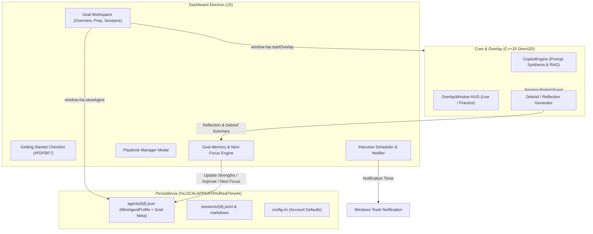

# Documento de Design — Goal Workspace & Prep Loop

## Overview

Esta especificação transforma cada meta de entrevista (**Goal**) do RealTimeAI em um workspace completo de preparação, substituindo o modal genérico de edição anterior por uma área de trabalho estruturada em três abas: **Overview**, **Prep** e **Sessions**.

A experiência integra visual e funcionalmente as referências de design do Final Round AI exibidas nas imagens do usuário:
- **Goals Horizon** (listagem de metas, card creme `#FDFBF7` de `Getting Started` com 4 etapas, barra de filtros `Current`/`Archived`, busca e tabela rica de status de metas).
- **Goal Workspace / Room** com breadcrumb (`Goals > empresa · cargo`), controles de estágio (`Update progress`: `Active`, `Interviewing`, `I got the offer`, `Moved on - archive`), agendador de entrevista (`When's the next round?` / `Edit date` / `Skip for now`) e as 3 abas fundamentais:
  - **Overview**: Próxima entrevista, status do contexto (`Goal context`), painel de aprendizado acumulado por IA **Goal Memory** ("What we know" com seções *Strength* e *Improve*) e sessões recentes.
  - **Prep**: Bloco **Next focus** (foco específico para a próxima sessão derivado da Goal Memory), **Goal brief** (resumo da empresa e job description com recon automático), **Knowledge sources** (currículo fixado e materiais anexados), **Response defaults** (Playbook com modal interativo de calibração comportamental, Answer language e Coding language com herança de conta) e botão **Start Practice**.
  - **Sessions**: Lista cronológica de debriefs/relatórios gerados por IA com estado visual de processamento (*Debrief Processing*), visualizador de debrief completo e estado vazio educativo.
- **New Playbook Modal**: Personalização de comportamento do copiloto com controles para *Answer length* (Concise, Balanced, Thorough), *Behavioral structure* (Auto, STAR, CAR, PAR, Direct), *Lead with the answer* (toggle), e *Name trade-offs unprompted* (toggle).
- **Integração C++ Overlay (Leitura & Escrita)**:
  - Consome o *Next Focus*, *Response Defaults* e *Knowledge Sources* enviados no perfil do agente e ajusta o comportamento e prompts do modelo no copiloto.
  - Ao encerrar a sessão (tanto live quanto prática), executa uma reflexão analítica gerada por IA (debrief) a partir da transcrição e sugestões.
  - O debrief gera o relatório da sessão e atualiza a **Goal Memory** (`strengths` e `improve`) e o **Next Focus** da meta correspondente.
- **Notificação Nativa do Windows**: Agendamento de alertas do sistema operacional aproximadamente 1 hora antes de cada entrevista marcada.

---

## Architecture & Data Flow



---

## Data Structures & Schemas

### 1. Extensão do Modelo do Goal (`MiniAgentProfile`)

No arquivo `src/core/include/rtai/mini_agent.hpp` e nos arquivos JSON `agents/{id}.json`:

```json
{
  "id": "nubank-senior-software-engineer",
  "name": "Nubank — Senior Software Engineer",
  "company": "Nubank",
  "role": "Senior Software Engineer",
  "job_description": "Arquitetura distribuída de baixa latência...",
  "company_research": "Cultura orientada a dados...",
  "stage": "Interviewing", 
  "next_interview": {
    "date": "2026-10-25",
    "time": "15:00",
    "timestamp_ms": 1792947600000
  },
  "next_focus": "Praticar concisão em exemplos de resiliência e quantificar impacto financeiro em respostas STAR.",
  "playbook": {
    "name": "Executivo STAR",
    "answer_length": "Balanced",
    "behavioral_structure": "STAR",
    "lead_with_answer": true,
    "name_tradeoffs": true
  },
  "response_defaults": {
    "answer_language": "pt-BR",
    "coding_language": "TypeScript"
  },
  "goal_memory": {
    "strengths": [
      "Clareza na explicação de arquiteturas distribuídas com alta disponibilidade.",
      "Excelente uso da primeira pessoa para demonstrar ownership de projetos críticos."
    ],
    "improve": [
      "Evitar detalhamento excessivo no contexto antes de declarar o resultado final (lead with verdict).",
      "Mencionar trade-offs de escolha de bancos SQL vs NoSQL espontaneamente."
    ]
  },
  "checklist_state": {
    "goal_created": true,
    "resume_added": true,
    "practice_run": false,
    "debrief_read": false
  },
  "documents": [...]
}
```

### 2. Estágios do Goal (`Goal_Stage`)
- `Active`: Meta em andamento e preparação ativa.
- `Interviewing`: Processo seletivo em fase de entrevistas.
- `I got the offer`: Oferta recebida (comemoração e encerramento positivo).
- `Moved on - archive`: Processo arquivado ou concluído.

### 3. Account Defaults (Herança de Configurações)
No `config.ini` sob `[account_defaults]` (ou `[llm]`):
- `default_answer_language`: Idioma padrão para respostas (padrão: `pt-BR`).
- `default_coding_language`: Linguagem de programação padrão (padrão: `Python` ou `TypeScript`).
- `default_playbook`: Playbook padrão inicial.

Quando o Goal não possui override explícito, herda visualmente indicando "(inherited from account)".

---

## Correctness Properties

### Property 1: Transição e Persistência de Estágio do Goal
*Para qualquer meta, a transição entre os 4 estágios (`Active`, `Interviewing`, `I got the offer`, `Moved on - archive`) via "Update progress" persiste o estado imediatamente no disco e atualiza o espelho do workspace e da listagem de Goals.*

### Property 2: Agendador e Cálculo de Notificação
*Para qualquer agendamento de `Next_Interview`, a notificação nativa do Windows é calculada para `T_entrevista - 1 hora`. Se o momento de disparo já tiver passado, nenhuma notificação futura é disparada. Em caso de "Skip for now", a notificação pendente é cancelada e o agendamento removido.*

### Property 3: Herança Determinística de Response Defaults
*Se um Goal não tiver `answer_language`, `coding_language` ou `playbook` definidos, os valores resolvidos para a sessão correspondem exatamente aos `Account_Defaults`. Quando um valor é sobrescrito no Goal, ele tem precedência sobre o padrão da conta. Ao limpar o override, o valor herdado é restaurado.*

### Property 4: Preservação e Filtragem de Knowledge Sources
*A adição e remoção de documentos na aba Prep atualiza atomicamente o array `documents[]` do Goal, mantendo os documentos do tipo `resume` acessíveis para ancoragem de currículo e `material` para RAG BM25.*

### Property 5: Condição de Exibição da Goal Memory e Next Focus
*O bloco "Next focus" na Prep e o conteúdo preenchido da Goal Memory na Overview são exibidos se e somente se houver ao menos uma Reflection/Debrief gerada por IA comprometida ao Goal. Na ausência de sessões, a interface exibe o estado neutro educativo correspondente à tela de referência.*

### Property 6: Debrief Processing e Acúmulo de Reflections
*Ao término de uma sessão (prática ou ao vivo), o sistema entra no estado `Debrief_Processing`, gera a reflexão por IA (pontos fortes e pontos a melhorar), salva o relatório em `sessions/` e compromete os novos aprendizados à `Goal_Memory` da meta, recalculando o `Next_Focus`.*

### Property 7: Injeção de Playbook no Overlay
*Quando o Overlay é iniciado para um Goal com playbook configurado (`answer_length`, `behavioral_structure`, `lead_with_answer`, `name_tradeoffs`), o motor de síntese de prompt incorpora as diretrizes comportamentais no prompt do sistema de forma idempotente e determinística.*

### Property 8: Checklist de Primeiros Passos
*As 4 etapas do card Getting Started (`Create a goal`, `Add your resume`, `Run a practice session`, `Read your debrief`) refletem fielmente o estado do usuário, marcando o checkmark visual assim que a ação correspondente é executada.*

### Property 9: Compatibilidade e Preservação de Modo Somente Transcrição
*A nova organização em workspaces e abas não degrada nem conflita com o Modo Somente Transcrição (implementado na spec anterior), mantendo o toggle e a geração de export/resumo operacionais.*

### Property 10: Integridade dos Ganchos de Interface
*Todas as referências a seletores e IDs utilizados pelo `app.js` e pelos testes unitários e de integração existentes continuam válidas e operantes.*

