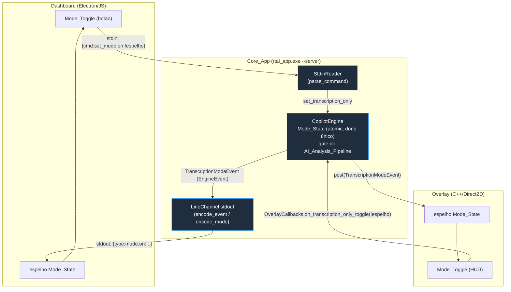

# Documento de Design — Modo Somente Transcrição

## Overview

Esta feature adiciona o **Modo Somente Transcrição** (`Transcription_Only_Mode`) ao copiloto RealTimeAI, reaproveitando ao máximo a arquitetura já existente em vez de criar um novo subsistema de comunicação. O ponto central é que o projeto já possui, hoje, **dois seams de propagação de estado** que juntos cobrem exatamente o `Mode_State_Channel` descrito nos requisitos:

1. **Dashboard (Electron/JS) ↔ Core_App (C++)** — um protocolo de linhas JSON sobre `stdin`/`stdout` (`rtai_app.exe --server`, definido em `src/core/include/rtai/server_protocol.hpp`). O `dashboard/main.js` já lança o processo do núcleo (`spawn`) e troca comandos/eventos nessa pipe. Cada comando da UI é um objeto `{"cmd": ...}`; cada evento do núcleo é um objeto `{"type": ...}`.
2. **Core_App (C++) ↔ Overlay (C++/Direct2D)** — o `CopilotEngine` publica `EngineEvent` (variant em `src/core/include/rtai/copilot_events.hpp`) para seus sinks via `OverlayWindow::post()` (barramento `WakeQueue` sem bloqueio da UI thread). O overlay dispara ações de volta por `OverlayCallbacks` (callbacks não-bloqueantes que chamam o engine).

O `Core_App` é o dono único do `Mode_State`. Ele é o ponto de convergência dos dois seams: toda alteração de modo — venha do Dashboard (comando `set_mode` no stdin) ou do Overlay (callback `on_transcription_only_toggle`) — é aplicada no engine, que então **republica** o novo valor para os dois lados (evento `{"type":"mode"}` no stdout para o Dashboard e `TranscriptionModeEvent` no barramento de eventos para o Overlay). Isso garante a sincronização bidirecional exigida pelo Requisito 2 sem nenhum canal novo.

O design espelha dois padrões que **já existem** no núcleo e resolvem quase toda a feature:

- **Toggle de pipeline já tem precedente**: `CopilotEngine::set_auto_answer(bool)` / `auto_answer()` com o evento `AutoAnswerStateEvent{enabled}`. O `Transcription_Only_Mode` é um gate análogo, porém mais forte: em vez de só desligar o disparo automático, ele suprime **toda** avaliação de trigger e **toda** chamada de LLM do caminho ao vivo, mantendo intactos o caminho de transcrição e o acúmulo de turnos.
- **Encerramento com IA já tem precedente**: `CopilotEngine::finalize_session()` entrega o `SessionTranscript` acumulado a um `IAnalyticsClient` (seam do Cold_Path) por meio de **uma** operação de encerramento, com resultado tudo-ou-nada publicado via `OverlayModeEvent`. O `Transcript_Export` + `Session_Summary` reutilizam o mesmo `SessionTranscript` (já populado para ambos os lanes em `session_transcript.hpp`) e a mesma mecânica de "uma única chamada de IA no encerramento".

As superfícies de código afetadas:

| Superfície | Arquivo | Papel nesta feature |
|---|---|---|
| Estado + gate do pipeline | `src/core/include/rtai/copilot_engine.hpp`, `src/core/src/copilot_engine.cpp` | `Mode_State` no engine, supressão do `AI_Analysis_Pipeline`, publicação de `TranscriptionModeEvent` |
| Modelo do evento | `src/core/include/rtai/copilot_events.hpp` | novo `TranscriptionModeEvent` |
| Encerramento/export + resumo | `src/core/include/rtai/transcript_export.hpp` (novo), `src/core/src/copilot_engine.cpp`, `src/app/src/main.cpp` | `Transcript_Export` (.txt/.md) e `Session_Summary` (1 chamada de IA) |
| Protocolo Dashboard↔Core | `src/core/include/rtai/server_protocol.hpp` | comando `set_mode`, evento `mode`, campo `mode` no `hello` |
| Orquestração da app | `src/app/src/main.cpp` | roteamento do comando `set_mode`, fiação do resumo/export no shutdown |
| Mode_Toggle nativo | `src/overlay/include/rtai/overlay_window.hpp`, `src/overlay/src/overlay_window.cpp` | botão/toggle no HUD, callback e reflexo visual do estado |
| Mode_Toggle Electron | `dashboard/src/index.html`, `dashboard/src/app.js`, `dashboard/preload.js`, `dashboard/main.js` | botão no dashboard, envio de `set_mode`, reflexo do evento `mode`, exibição do resumo |

O idioma de todo o produto e da UI permanece português (pt-BR).

## Architecture

### Invariante central: Core_App é o dono único do Mode_State

Nenhuma superfície guarda uma cópia "autoritativa" do estado. Dashboard e Overlay mantêm apenas uma cópia **espelho** usada para renderizar o `Mode_Toggle`. A fonte da verdade é um `std::atomic<bool>` dentro do `CopilotEngine`. O fluxo de uma alternância é sempre o mesmo, independentemente da superfície que a iniciou:

1. A `Surface` **solicita** a troca para o valor oposto ao que ela exibe (ela não aplica localmente de forma otimista).
2. O `Core_App` recebe a solicitação, aplica o novo `Mode_State` e (se mudou) reconfigura o gate do pipeline.
3. O `Core_App` **republica** o valor efetivo para **ambas** as superfícies.
4. Cada superfície atualiza seu espelho ao receber a republicação.

Como a republicação vai para as duas superfícies (inclusive a que originou), o estado converge mesmo se a UI tiver aplicado algo otimista; e uma superfície que se conecta depois recebe o valor corrente no `hello` (Req 2.5). Esse padrão "request → aplica no dono → republica para todos" elimina divergência e corrida entre superfícies (Req 2.6).



### Gate do AI_Analysis_Pipeline

O `CopilotEngine` roda toda a sua lógica numa única thread orquestradora (dona da `DecisionPolicy`, do `TurnAssembler` e das chamadas de LLM). O gate é um `std::atomic<bool> transcription_only_` lido nesse mesmo fluxo. A regra é cirúrgica:

- **Mantém-se intacto** o caminho de transcrição: `on_transcript()` continua alimentando o `TurnAssembler`, continua publicando `TranscriptUpdateEvent` (texto ao vivo) e `TurnEvent` (turno fechado), e continua anexando cada turno fechado ao `SessionTranscript`. O Dashboard e o Overlay continuam recebendo texto normalmente (Req 3.2).
- **Suprime-se** tudo o que inicia resposta por IA ao vivo: quando `transcription_only_ == true`, o engine **não** avalia triggers da `DecisionPolicy`, **não** inicia disparo especulativo (Hot_Path/Shadow Streaming) e **não** chama o `ILlmClient` para sugestões. Nenhuma `SuggestionStartedEvent`/`SuggestionDeltaEvent`/`SuggestionDoneEvent` é emitida (Req 3.1, 3.3).
- A transição é **imediata**: ao ligar o modo no meio da sessão, uma geração em andamento é cancelada da mesma forma que o engine já aborta gerações (incremento de `generation_id_` + cancelamento da chamada remota), e nenhuma nova é iniciada (Req 3.4). Ao desligar, o engine volta a avaliar triggers a partir daquele momento, respeitando o `auto_answer()` e o `cooldown_ms` que já existiam (Req 3.5, 3.6).

Pontos exatos no `copilot_engine.cpp` (caminho único, orquestrador):
- No tratamento de turno fechado e de interim estável: a avaliação de `DecisionPolicy::evaluate(...)` e o início de `Speculative_Turn` passam a ser guardados por `if (!transcription_only_) { ... }`.
- `request_suggestion()` / `request_action(...)` manuais: **também** suprimidos enquanto o modo está ativo, porque o requisito proíbe qualquer chamada de API do `AI_Analysis_Pipeline` durante a sessão (Req 3.3). Nesse caso o engine publica um `NoticeEvent{Info}` em pt-BR ("Modo somente transcrição ativo: sugestões por IA desativadas.") em vez de disparar.
- O acúmulo em `SessionTranscript` fica **fora** do gate (sempre executa), pois é o que alimenta export e resumo no encerramento.

### Encerramento: Transcript_Export + Session_Summary

Dois gatilhos levam ao encerramento do modo (Req 4.1/4.2 e 5.1/5.2):

- **Desativar o modo** depois de ele ter estado ativo na sessão.
- **Session_End** (encerrar a sessão) enquanto o modo está ativo. No código atual isso corresponde ao fim do loop principal em `main.cpp` (sinal `g_stop_event`, EOF no stdin, "Encerrar"/Ctrl+Alt+Q no overlay) seguido do shutdown ordenado.

Em ambos os casos o `Core_App` executa, nesta ordem e **uma única vez** por ativação do modo (um flag `summary_pending_` evita duplicar se desativar e depois encerrar):

1. **Transcript_Export (determinístico, sem IA)**: serializa o `SessionTranscript` acumulado para um arquivo `.txt` ou `.md`, com o texto verbatim de cada turno na ordem cronológica de fechamento. Reutiliza `SessionTranscript::render()` (já produz uma linha rotulada por turno: `Entrevistador:`/`Candidato:`) para o `.txt`; para o `.md` usa um cabeçalho leve + a mesma renderização. O arquivo é gravado ao lado das sessões (`%LOCALAPPDATA%\RealTimeAI\sessions\`), seguindo o padrão do `SessionStore`. Se a gravação falhar, o erro é registrado (log + `NoticeEvent{Error}`) e o `SessionTranscript` permanece em memória, sem perder dados (Req 4.5).
2. **Session_Summary (uma única chamada de IA)**: monta uma requisição de LLM a partir de `SessionTranscript::render()` e a envia **uma só vez**, reaproveitando o cliente leve OpenRouter já instanciado em `main.cpp` (`openrouter_sol_client`, modelo `qwen/qwen3.6-flash`). Isso é feito **somente** no encerramento, nunca durante a captura (Req 5.3). Em sucesso, o resumo é entregue ao Dashboard por um evento `{"type":"summary","text":...}` para exibição (Req 5.4). Em falha, o `Transcript_Export` já gerado é preservado e o usuário é informado via `NoticeEvent{Warning}` + evento `summary` com `ok:false` ("Resumo não pôde ser gerado; a transcrição foi exportada.") (Req 5.5).

O resumo **não** reutiliza o Cold_Path/Jev (que produz três notas e feedback) porque o requisito pede um resumo textual único da chamada, não o relatório de desempenho. Ele usa o mesmo *padrão* de encerramento (uma chamada no fim, resultado entregue à UI), mas um prompt próprio de sumarização em pt-BR. A operação é modelada como um método de encerramento no engine — `CopilotEngine::finalize_transcription_mode(export_sink, summary_llm)` — ou, de forma equivalente e mais simples de testar, uma função pura de montagem (`transcript_export.hpp`) chamada por `main.cpp`, que então dispara a chamada de IA. Esta é a decisão de design: **a montagem do export e do prompt do resumo é pura e testável; o I/O (gravar arquivo, chamar LLM) fica na borda (`main.cpp`)**, espelhando como `SessionStore::render_markdown` é puro e o `open/close` faz o I/O.

### Threading e não-bloqueio

Todas as entradas novas respeitam o invariante "never block the UI thread" já praticado no projeto:
- O comando `set_mode` chega pela `StdinReader` (thread dedicada) e só chama `engine->set_transcription_only(on)` (enfileira + notifica, atômico).
- O callback `on_transcription_only_toggle` do overlay é não-bloqueante (igual a `on_auto_toggle`).
- `TranscriptionModeEvent` trafega pelo mesmo barramento `WakeQueue`/`post()` dos demais eventos, coalescido no dreno da UI thread do overlay.
- A chamada de IA do resumo é assíncrona (callback em worker thread), como o Deep-Reading e o Cold_Path já fazem; o resultado é roteado de volta e só então serializado para o stdout.

## Components and Interfaces

### 1. `copilot_events.hpp` — novo evento

```cpp
// Alternância do Modo Somente Transcrição. Publicado pelo engine (dono único do
// estado) sempre que o Mode_State é aplicado, inclusive no hello de conexão,
// para sincronizar Dashboard e Overlay (Req 2.2/2.3/2.4).
struct TranscriptionModeEvent {
    bool enabled{false};
    std::int64_t t_ms{0};
};
```

O `EngineEvent` variant passa a incluir `TranscriptionModeEvent`. O `encode_event` em `server_protocol.hpp` ganha o ramo que o serializa como `{"type":"mode","on":<bool>}`; os sinks de console/sessão o ignoram (como já fazem com eventos que não lhes interessam).

### 2. `copilot_engine.hpp` — estado e gate

```cpp
// --- adições a CopilotEngine (API pública) ---
// Liga/desliga o Modo Somente Transcrição. Thread-safe e não-bloqueante
// (enfileira + notifica). Idempotente: aplicar o mesmo valor não republica.
// Ao ligar durante a sessão, aborta geração em andamento e para de avaliar
// triggers (Req 3.1/3.3/3.4). Ao desligar, retoma a avaliação (Req 3.5).
// Sempre que o valor efetivo muda, publica TranscriptionModeEvent{enabled}.
void set_transcription_only(bool on);
[[nodiscard]] bool transcription_only() const noexcept;
```

Internamente (`Impl`, orquestrador): `std::atomic<bool> transcription_only_{false}` e, no tratamento de turnos/interins/ações manuais, os guards `if (!transcription_only_)` descritos acima. O `SessionTranscript` já é alimentado antes da avaliação de trigger, então fica naturalmente fora do gate.

### 3. `transcript_export.hpp` (novo, puro) — montagem de export e prompt

```cpp
namespace rtai {

enum class TranscriptExportFormat : std::uint8_t { Txt, Md };

// Monta o conteúdo do Transcript_Export a partir do SessionTranscript, verbatim
// e em ordem cronológica de fechamento (Req 4.3/4.4). .txt = render() direto;
// .md = cabeçalho leve + render(). Função pura, testável sem I/O.
[[nodiscard]] std::string build_transcript_export(const SessionTranscript& t,
                                                  TranscriptExportFormat fmt);

// Monta as mensagens da ÚNICA chamada de IA do Session_Summary (Req 5.1/5.3).
// System prompt em pt-BR orientado a resumo fiel da chamada; user = render().
[[nodiscard]] std::vector<ChatMessage> build_summary_request(const SessionTranscript& t);

} // namespace rtai
```

O I/O correspondente vive em `main.cpp`: gravar o arquivo (tratando falha → Req 4.5) e disparar `openrouter_sol_client->start(...)` com as mensagens de `build_summary_request`, roteando o resultado para o evento `summary`.

### 4. `server_protocol.hpp` — comando e eventos

Engine → UI (stdout):
- `hello` ganha o campo `mode` (bool) para que a `Surface` receba o valor corrente ao conectar (Req 2.5): `"mode": <bool>`.
- Novo evento republicado a cada troca: `{"type":"mode","on":<bool>}`.
- Novo evento de encerramento do resumo: `{"type":"summary","ok":<bool>,"text":<string>,"export":<path>}`.

UI → engine (stdin): novo comando em `Command::Kind` e no `parse_command`:
```jsonc
{"cmd":"set_mode","on":true}   // solicita Mode_State = on (Req 1.3/1.4)
```
`parse_command` adiciona o ramo `cmd == "set_mode"` preenchendo `Command{Kind::SetMode, paused=on}` (ou um campo booleano dedicado `mode_on`). `main.cpp` roteia `K::SetMode` para `engine->set_transcription_only(c->mode_on)`.

### 5. `overlay_window.hpp` / `overlay_window.cpp` — Mode_Toggle nativo

```cpp
// --- OverlayOptions: estado inicial do toggle ---
bool transcription_only_on{false};

// --- OverlayCallbacks: ação do toggle (não-bloqueante, como on_auto_toggle) ---
std::function<void(bool on)> on_transcription_only_toggle;
```

No HUD, o `Mode_Toggle` entra na control bar (mesma faixa onde já vivem os toggles de áudio e o toggle de auto-resposta), rotulado "Somente transcrição" (com uma forma curta quando a largura é pequena, seguindo o padrão de colapso de rótulos já existente). Estado visual (Req 1.6):
- **Ativado**: toggle preenchido/aceso; a área de resposta do card exibe um estado neutro ("Modo somente transcrição — sugestões por IA desativadas") em vez de sugestões.
- **Desativado**: toggle apagado; card volta ao comportamento de LiveCopilot.

Interação (Req 1.2/1.4): o clique chama `callbacks.on_transcription_only_toggle(!modelo.transcription_only)` — solicita o oposto do espelho, **não** altera o espelho localmente. O espelho só muda quando chega `TranscriptionModeEvent` pelo `post()`, aplicado no dreno do modelo plano (Req 2.4). Uma hotkey discreta (ex.: Ctrl+Alt+M) pode acompanhar o clique, seguindo o conjunto de hotkeys já documentado em `overlay_window.hpp`.

`main.cpp` fia o callback: `ocb.on_transcription_only_toggle = [engine](bool on){ engine->set_transcription_only(on); };` e inicializa `oo.transcription_only_on` a partir do estado corrente do engine.

### 6. Dashboard (Electron) — Mode_Toggle e resumo

- `preload.js`: expõe `setMode: (on) => ipcRenderer.invoke('rtai:set-mode', on)` e assinantes `onModeChanged(cb)` e `onSessionSummary(cb)` sobre `ipcRenderer.on('rtai:mode', ...)` / `ipcRenderer.on('rtai:summary', ...)`, no mesmo padrão de `onOverlayStatus`.
- `main.js`: no `child_process` do overlay/núcleo, ao receber uma linha `{"type":"mode"}` encaminha para a janela via `webContents.send('rtai:mode', on)`; `{"type":"summary"}` → `rtai:summary`. O handler `ipcMain.handle('rtai:set-mode', ...)` escreve `{"cmd":"set_mode","on":...}\n` no `stdin` do processo do núcleo. (Hoje o `main.js` troca config por `config.ini`; para o estado ao vivo do modo, o canal correto é a pipe JSON do `--server`, que é o mesmo processo já gerenciado.)
- `index.html` + `app.js`: um botão/toggle "Somente transcrição" na barra de status/sessão. O clique chama `window.rtai.setMode(!state.transcriptionOnly)` (solicita o oposto do espelho). `state.transcriptionOnly` só é atualizado em `onModeChanged` (Req 2.3), que também atualiza o reflexo visual (Req 1.5). `onSessionSummary` exibe o `Session_Summary` (Req 5.4) — por exemplo, num card na view de histórico/sessão — ou um aviso quando `ok:false` (Req 5.5).

### Mapeamento de rastreabilidade

| Requisito | Onde é atendido |
|---|---|
| 1.1, 1.3, 1.5 | Dashboard: botão + `setMode(!espelho)` + reflexo em `onModeChanged` |
| 1.2, 1.4, 1.6 | Overlay: `Mode_Toggle` na control bar + `on_transcription_only_toggle(!espelho)` + estado visual |
| 2.1, 2.6 | `CopilotEngine` dono único do `Mode_State` (atomic) |
| 2.2 | `set_transcription_only` republica `TranscriptionModeEvent` para os dois seams |
| 2.3, 2.4 | Dashboard/Overlay atualizam espelho ao receber `mode`/`TranscriptionModeEvent` |
| 2.5 | Campo `mode` no `hello`; overlay recebe estado via `OverlayOptions` + primeiro evento |
| 3.1, 3.3, 3.4 | Gate `if(!transcription_only_)` em triggers/especulativo/ações manuais; aborto de geração |
| 3.2 | `on_transcript`/`TranscriptUpdateEvent`/`TurnEvent` fora do gate |
| 3.5, 3.6 | Desligar retoma avaliação respeitando `auto_answer`/`cooldown` |
| 4.1, 4.2 | `main.cpp` chama o export ao desativar o modo e no `Session_End` |
| 4.3, 4.4 | `build_transcript_export` (.txt/.md, verbatim, cronológico) |
| 4.5 | Falha de gravação: log + `NoticeEvent{Error}`, `SessionTranscript` preservado |
| 5.1, 5.2, 5.3 | `build_summary_request` + 1 chamada em `openrouter_sol_client` só no encerramento |
| 5.4 | Evento `{"type":"summary",ok:true,...}` → Dashboard exibe |
| 5.5 | Falha: export preservado + `summary ok:false` + `NoticeEvent{Warning}` |

## Data Models

- **Mode_State** → `std::atomic<bool> transcription_only_` no `CopilotEngine::Impl` (dono único). Espelhos: `state.transcriptionOnly` (JS) e `model.transcription_only` (overlay).
- **TranscriptionModeEvent** `{ bool enabled; std::int64_t t_ms; }` — veículo da propagação no barramento interno e base do `{"type":"mode"}`.
- **Session_Transcript** → `SessionTranscript` existente (`std::vector<TranscriptTurn>`, campos `track`, `text` verbatim, `start_ms`, `end_ms`, `seq`), já alimentado para ambos os lanes.
- **Transcript_Export** → string (conteúdo `.txt`/`.md`) + caminho de arquivo em `sessions/`.
- **Session_Summary** → string de texto retornada pela única chamada de IA.

## Error Handling

- **Comando `set_mode` malformado** no stdin: `parse_command` retorna erro; `main.cpp` apenas registra "comando inválido" (comportamento já existente) e ignora. O `Mode_State` não muda.
- **Toggle idempotente**: aplicar o mesmo valor não republica nem reconfigura o pipeline, evitando eventos redundantes e flicker nos espelhos.
- **Falha ao gravar o Transcript_Export** (Req 4.5): captura o `std::error_code`/exceção de I/O, loga, emite `NoticeEvent{Error}` em pt-BR e mantém o `SessionTranscript` em memória. O resumo ainda é tentado (são passos independentes).
- **Falha na chamada de IA do Session_Summary** (Req 5.5): o callback recebe status != Completed (ou texto vazio); o engine/app preserva o export já gravado e publica `{"type":"summary","ok":false,...}` + `NoticeEvent{Warning}`. Nenhuma segunda chamada é feita (Req 5.1/5.3: "uma única chamada").
- **Sem chave de LLM / modo demo**: o resumo é pulado com aviso informativo; o export determinístico continua sendo gerado normalmente.
- **Reentrância de encerramento**: `summary_pending_` garante que desativar-e-depois-encerrar não gere export/resumo duplicados.

## Testing Strategy

Abordagem dupla, alinhada ao restante do núcleo (que é compilado e testado com CMake em `tests/core_tests`, independentemente do Win32):

- **Testes unitários (exemplos e casos de borda)**: parsing do comando `set_mode`; serialização de `TranscriptionModeEvent` como `{"type":"mode","on":...}`; campo `mode` no `hello`; `build_transcript_export` para `.txt` e `.md` com 0, 1 e N turnos; `build_summary_request` montando exatamente uma mensagem de sistema + uma de usuário; idempotência de `set_transcription_only`.
- **Testes de propriedade (entradas universais)**: ver seção de Correctness Properties. Focados no gate (supressão total de sugestões vs. preservação da transcrição), na convergência do estado após propagação e na fidelidade verbatim/ordem do export.

Configuração dos testes de propriedade: mínimo de 100 iterações por propriedade; cada teste referencia a propriedade de design correspondente com a tag **Feature: transcription-only-mode, Property {n}: {texto}**.

## Correctness Properties

*Uma propriedade é uma característica ou comportamento que deve valer em todas as execuções válidas do sistema — uma afirmação formal sobre o que o sistema deve fazer. As propriedades são a ponte entre a especificação legível por humanos e garantias de correção verificáveis por máquina.*

### Property 1: Toggle solicita o valor oposto ao espelho

*Para qualquer* superfície (Dashboard ou Overlay) e *qualquer* valor booleano `m` exibido no seu espelho do `Mode_State`, acionar o `Mode_Toggle` SHALL emitir uma solicitação de troca cujo valor é `!m`, sem alterar o espelho localmente.

**Validates: Requirements 1.3, 1.4**

### Property 2: O espelho segue a última republicação recebida

*Para qualquer* sequência de republicações de `Mode_State` entregues a uma superfície (via `TranscriptionModeEvent` no Overlay ou evento `{"type":"mode"}` no Dashboard), o valor exibido no `Mode_Toggle` após processar a sequência SHALL ser igual ao último valor da sequência.

**Validates: Requirements 1.5, 1.6, 2.3, 2.4**

### Property 3: Toda troca efetiva é propagada

*Para qualquer* valor booleano solicitado a `set_transcription_only`, quando esse valor difere do `Mode_State` corrente, o `Core_App` SHALL publicar exatamente um `TranscriptionModeEvent` cujo `enabled` é igual ao valor aplicado; quando o valor é igual ao corrente, nenhum evento é publicado (idempotência).

**Validates: Requirements 2.2**

### Property 4: Convergência do estado após propagação

*Para qualquer* solicitação de troca originada por qualquer superfície, após o `Core_App` aplicar o valor e a republicação ser entregue às superfícies, o `Mode_State` do `Core_App`, o espelho do Dashboard e o espelho do Overlay SHALL ser todos iguais ao valor aplicado.

**Validates: Requirements 2.1, 2.6**

### Property 5: O hello de conexão carrega o estado corrente

*Para qualquer* valor corrente `s` do `Mode_State`, o `hello` enviado a uma `Surface` que se conecta SHALL conter o campo `mode` igual a `s`.

**Validates: Requirements 2.5**

### Property 6: Modo ativo suprime todo o AI_Analysis_Pipeline

*Para qualquer* fluxo de eventos de transcrição e *qualquer* conjunto de ações manuais (pedir sugestão, chat, screenshot, recap, follow-up), enquanto o `Transcription_Only_Mode` está Ativado o `Core_App` SHALL não emitir nenhuma `SuggestionStartedEvent`/`SuggestionDeltaEvent`/`SuggestionDoneEvent` e não realizar nenhuma chamada ao `ILlmClient` do caminho ao vivo (contagem de chamadas = 0).

**Validates: Requirements 3.1, 3.3**

### Property 7: Modo ativo preserva o caminho de transcrição

*Para qualquer* fluxo de `N` turnos fechados recebidos enquanto o `Transcription_Only_Mode` está Ativado, o `Core_App` SHALL continuar emitindo os eventos de transcrição ao vivo e de turno correspondentes e o `Session_Transcript` acumulado SHALL conter exatamente esses `N` turnos.

**Validates: Requirements 3.2**

### Property 8: Export verbatim e em ordem cronológica

*Para qualquer* `Session_Transcript`, o `Transcript_Export` gerado (em `.txt` ou `.md`) SHALL conter o texto de cada turno byte a byte (verbatim) e na mesma ordem cronológica de fechamento dos turnos, de modo que a sequência de textos extraída do export seja idêntica à sequência de textos dos turnos.

**Validates: Requirements 4.4**

### Property 9: Uma única chamada de IA de resumo, apenas no encerramento

*Para qualquer* ativação do `Transcription_Only_Mode` com `Session_Transcript` não vazio, o `Core_App` SHALL realizar no máximo uma chamada de IA de `Session_Summary` por ativação, e essa chamada SHALL ocorrer somente no encerramento (desativação do modo ou `Session_End`) — nunca enquanto a captura ao vivo está em andamento (contagem de chamadas de resumo durante a captura = 0).

**Validates: Requirements 5.1, 5.2, 5.3**

